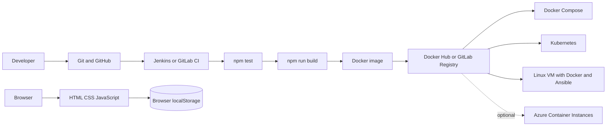

# Student Task Manager — End-to-End DevOps Mini Project

A small, browser-based task manager used to demonstrate development, testing, packaging, and deployment practices from a five-unit DevOps syllabus. The application uses HTML, CSS, vanilla JavaScript, and browser `localStorage`; the DevOps tooling around it is intentionally optional.

## Problem statement and objectives

Students need a simple way to track assignments, while the project demonstrates how a small application can move reliably from source control through automated tests and packaging to deployment. The goals are to:

- Keep the application easy to understand and run without a server or cloud account.
- Apply Git/Gitflow, npm, automated tests, and CI/CD.
- Package the static website as an unprivileged Nginx container.
- Demonstrate Compose, Kubernetes, Swarm, and configuration-management alternatives.
- Explain Agile collaboration, cloud operations, security, and recovery.

## Features

- Add a task with a title and optional description.
- Mark a task completed or pending; delete tasks.
- Filter by All, Pending, or Completed.
- View total, pending, and completed counts.
- Responsive layout and success/error feedback.

Tasks are stored only in the current browser's `localStorage`. They are not synchronized to another browser or device. Clearing browser site data removes them.

## Architecture



## Project structure

```text
public/                  Browser application
  app.js
  index.html
  styles.css
tests/
  app.test.js             Node.js built-in test suite
scripts/
  build.js                Cross-platform static packaging
  serve.js                Optional local Node.js web server
  build.sh                Shell wrapper for npm run build
  deploy.sh               SSH deployment of an image to a Linux VM
docker/
  nginx.conf
k8s/
  deployment.yaml
  service.yaml
ansible/
  inventory.ini.example
  playbook.yml
puppet/
  student_task_manager.pp
saltstack/
  top.sls
  student_task_manager.sls
Dockerfile
docker-compose.yml
Jenkinsfile
.gitlab-ci.yml
package.json
package-lock.json
DEVOPS_MAPPING.md
README.md
LICENSE
```

## Prerequisites

| Purpose | Required tools |
|---|---|
| Use the application | Current Chrome, Edge, Firefox, or another modern browser |
| Run tests and build | Node.js 20+ and npm 10+ |
| Version control | Git; GitHub account only to publish remotely |
| Container demonstrations | Docker Engine/Desktop with Compose v2 |
| CI/CD | Jenkins with a Docker-capable agent, or a GitLab project and suitable runner |
| Kubernetes | Minikube (and a driver such as Docker) plus `kubectl` |
| Linux VM automation | Ansible on the control machine, SSH access, Ubuntu/Debian target |
| Puppet/Salt labs | Separate Linux lab hosts with Puppet or Salt installed |
| Cloud examples | Cloud account and CLI; cloud usage may incur charges |

Only a browser is needed to use the app. No install step or web server is required for basic use. Node.js is needed only for tests, build, and the optional `npm start` server. Docker, Kubernetes, CI services, and cloud accounts are optional.

## Run locally

### Open the static page

Open `public/index.html` from your file manager. On Windows PowerShell, from the project directory:

```powershell
Start-Process .\public\index.html
```

### Run using npm

```powershell
npm ci
npm test
npm run build
npm start
```

`npm ci` installs from the committed lockfile; there are no third-party npm packages. `npm start` serves `public/` at `http://127.0.0.1:8080` and stays running in that terminal. Press Ctrl+C to stop it. To change port, set `PORT` before starting (for example `$env:PORT=9000; npm start` in PowerShell).

The build copies the three static assets into `dist/`. `dist/` is generated and ignored by Git.

## Tests and npm

`package.json` defines `test`, `build`, and `start`. Tests use Node's built-in `node:test` and `node:assert`; no test framework is installed. `package-lock.json` keeps npm installs reproducible. A failed test exits non-zero, so both CI pipelines stop before packaging or publishing.

```powershell
npm test
npm run build
```

## Unit I — DevOps, Agile, and cloud

### DevOps lifecycle and collaboration

DevOps combines development and operations practices to shorten and improve the feedback loop from planning through coding, building, testing, release, deployment, operation, and monitoring. Developers contribute application and test knowledge; operations contributors bring deployment, availability, capacity, and recovery knowledge; security and product stakeholders contribute controls and user priorities. Teams share responsibility for quality and operability rather than handing work across isolated silos.

Agile helps teams deliver small, reviewable increments and adapt to feedback. DevOps extends that feedback into build, release, and operations through automation, shared ownership, observable results, and repeatable environments. Typical barriers include manual handoffs, inconsistent environments, unclear ownership, and fear of failures. Code review, automated tests, versioned images, deployment automation, logs, and rollback procedures address these barriers. Automation supports collaboration; it does not replace communication or accountability.

### Example Agile project plan

**Product goal:** let a student record and manage a personal task list in a browser.

| Backlog item / user story | Acceptance criteria |
|---|---|
| As a student, I can add a task. | A non-empty title is saved; description is optional; blank title shows an error. |
| As a student, I can update task status. | Done/Undo changes status and the counters update. |
| As a student, I can filter and delete tasks. | Each filter shows the right tasks; deletion removes the task. |
| As a maintainer, I can verify and package changes. | `npm test` and `npm run build` succeed; CI blocks on failing tests. |
| As an operator, I can run a repeatable deployment. | Docker/Compose or documented orchestration tools serve the site on the documented port. |

**Two illustrative sprints:** Sprint 1 delivers the browser UI, local persistence, responsive layout, and unit tests. Sprint 2 adds Docker packaging, CI pipelines, deployment examples, and syllabus documentation. These are sample learning increments, not claims about a team sprint already completed.

Scrum roles: Product Owner orders the backlog, Scrum Master facilitates and removes blockers, and Developers build/test/document the increment. Sprint planning selects a goal and work; a short daily stand-up shares progress and blockers; sprint review demonstrates the increment; retrospective chooses a process improvement.

**Sample Kanban board**

| To Do | In Progress | Testing | Done |
|---|---|---|---|
| Add status filters | Implement task UI | Run `npm test` | Create repository |
| Draft cloud procedure | Prepare container | Review CI pipeline | Document acceptance criteria |

Move work across the columns as it progresses; keep work visible and limit unfinished work rather than treating this sample as a live project board.

### Cloud as a platform

Cloud platforms provide on-demand self-service, network access, pooled infrastructure, elasticity, and measured usage. DevOps can provision environments quickly and consistently using automation, while monitoring usage and setting budgets/alerts helps control cost. Images and configuration can make environments more reproducible, but cloud region, identity, network, and service differences must still be managed deliberately.

## Unit II — Git and Gitflow

Verify Git and set the identity used in commits:

```powershell
git --version
git config --global user.name "Your Name"
git config --global user.email "you@example.com"
```

For a new local repository:

```powershell
git init -b main
git status
git add .
git diff --cached
git commit -m "Initial Student Task Manager"
git log --oneline
git branch --list
```

After creating an empty GitHub repository (do not initialize it with another README), connect and publish:

```powershell
git remote add origin https://github.com/<USERNAME>/<REPOSITORY>.git
git remote -v
git fetch origin
git push -u origin main
```

Clone an existing repository with `git clone https://github.com/<USERNAME>/<REPOSITORY>.git`. Use `git fetch` to retrieve remote commits without merging; `git pull` fetches and integrates; `git diff` inspects unstaged changes; `git merge` integrates a branch. A repository stores project history; the working tree is your files; the staging area selects the next commit; a commit is a saved snapshot; a branch is a movable line of work; a remote is another repository location. A merge conflict means Git needs you to reconcile edits to the same content before committing.

### Gitflow-inspired workflow

This repository does not enforce Gitflow automatically; these commands demonstrate the branch convention. `main` contains releases, `develop` integrates work, and short-lived `feature/*`, `release/*`, and `hotfix/*` branches isolate changes.

```powershell
# Start develop from main
git switch main
git pull
git switch -c develop
git push -u origin develop

# Work on a feature
git switch develop
git switch -c feature/task-filters
# edit files, then:
git add .
git commit -m "Add task status filters"
git push -u origin feature/task-filters
# Open a pull request into develop; review before merging.
git switch develop
git merge --no-ff feature/task-filters
git push

# Prepare and publish a release
git switch -c release/1.0.0 develop
# run tests, update version/docs, commit release fixes
git add .
git commit -m "Prepare release 1.0.0"
git switch main
git merge --no-ff release/1.0.0
git tag -a v1.0.0 -m "Release 1.0.0"
git push origin main --tags
git switch develop
git merge --no-ff release/1.0.0
git push

# Fix a production issue
git switch main
git switch -c hotfix/1.0.1
# edit and test
git add .
git commit -m "Fix production issue"
git switch main
git merge --no-ff hotfix/1.0.1
git tag -a v1.0.1 -m "Release 1.0.1"
git push origin main --tags
git switch develop
git merge --no-ff hotfix/1.0.1
git push
```

If Git marks conflict markers (`<<<<<<<`, `=======`, `>>>>>>>`), edit the file to the intended combined result, remove markers, inspect with `git diff`, run tests, then `git add <file>` and complete the merge with `git commit`.

## Unit III — CI/CD

The Jenkinsfile is the primary example. `.gitlab-ci.yml` is an alternative; use one pipeline for the demonstration unless comparing them. Both run tests before packaging/container image creation. The build uses a generated `dist/` directory, while the Docker image serves the source static assets directly.

### Jenkins

Use a Jenkins Multibranch Pipeline (recommended) or Pipeline-from-SCM job pointed at this GitHub repository and `Jenkinsfile`. Jenkins agents need Git, Node.js 20/npm 10, Docker CLI, permission to access a Docker daemon, and the Docker Pipeline and Credentials plugins. The Jenkinsfile targets an agent labelled `docker`; configure an isolated agent with that label. Do not solve access problems by making agents privileged or granting broad host access.

Add a Jenkins username/password credential with ID `dockerhub` (Docker Hub username and access token). For optional test deployment, add an SSH private-key credential with ID `test-host-ssh` using the SSH Agent plugin, configure `TEST_HOST` on the Jenkins controller/job as the host name or IP, and ensure the agent trusts the host's verified SSH host key. The `PUBLISH_IMAGE` parameter publishes a numbered image; `DEPLOY_TEST` is gated to `main`, publishes first, then asks for manual approval. The remote host must have Docker and allow SSH; configure its firewall intentionally.

Stages: checkout, `npm ci`, tests, build/archive, Docker build, optional Docker Hub publish, optional approved main-branch test deployment. A test failure stops later stages. Never put tokens or private keys in the repository.

### GitLab CI

Add the project to GitLab and use `.gitlab-ci.yml`. The test/package jobs use a Node image. The container job uses Docker-in-Docker with TLS and pushes a commit-SHA image to GitLab Container Registry on the default branch. Configure a dedicated, trusted runner with Docker-in-Docker enabled, a privileged runner configuration for the DinD service, and a shared `/certs/client` volume as required by the GitLab Runner Docker executor. TLS protects the client connection, but DinD still expands runner trust/privilege and should not be enabled on an untrusted shared runner. If the runner cannot support this safely, omit the image job or use an approved rootless builder.

To try the optional manual Azure ACI job, add protected/masked CI/CD variables `AZURE_CLIENT_ID`, `AZURE_CLIENT_SECRET`, `AZURE_TENANT_ID`, `AZURE_SUBSCRIPTION_ID`, `AZURE_RESOURCE_GROUP`, `AZURE_LOCATION`, `ACI_NAME`, globally unique `ACI_DNS_LABEL`, and a long-lived read-only GitLab registry deploy token as `ACI_REGISTRY_USERNAME` and `ACI_REGISTRY_PASSWORD`. Do not use the short-lived `CI_REGISTRY_PASSWORD` for ACI's later image pull. The principal needs permission to deploy containers in the resource group. Protect the default branch and restrict who can start deployment. The job is manual and is not required for local CI.

### Docker Hub

Create a Docker Hub repository and use an access token rather than an account password. For the simple SSH deployment script, make the image public or arrange a secure Docker Hub login on the target host before deploying:

```powershell
docker login --username <DOCKERHUB_USERNAME>
docker build -t <DOCKERHUB_USERNAME>/student-task-manager:1.0.0 .
docker push <DOCKERHUB_USERNAME>/student-task-manager:1.0.0
docker pull <DOCKERHUB_USERNAME>/student-task-manager:1.0.0
```

## Unit IV — Docker and orchestration

### Docker image and container

The Dockerfile uses the lightweight Nginx unprivileged image, copies only `public/` and the Nginx configuration, listens on container port `8080`, and provides a health check. An image is an immutable template made of layers; a container is a running instance. A registry stores/publishes images. Port mapping exposes a container port through a host port; this static site needs no persistent volume.

```powershell
docker build -t student-task-manager:local .
docker run -d --name stm -p 8080:8080 student-task-manager:local
docker ps
docker logs stm
docker inspect stm
# open http://localhost:8080
docker stop stm
docker rm stm
docker image tag student-task-manager:local <DOCKERHUB_USERNAME>/student-task-manager:1.0.0
```

Use the Docker Hub push/pull commands in the CI/CD section. For an isolated CLI example, `docker run --rm -it node:20-alpine node --version` runs Node in a disposable container without installing it on the host.

### Docker Compose

Compose gives repeatable port/restart/build configuration even for this one-service app:

```powershell
docker compose up --build -d
docker compose ps
docker compose logs -f
# After changing the app:
docker compose up --build -d
docker compose down
```

### Kubernetes with Minikube

Kubernetes is optional and installed separately. Local resource requirements depend on the selected Minikube driver and machine.

```powershell
minikube start
minikube image build -t student-task-manager:local .
kubectl apply -f k8s/
kubectl get deployments,pods
kubectl get services
minikube service student-task-manager --url
# Roll out a different image (replace the placeholder with a real, pushed tag):
kubectl set image deployment/student-task-manager student-task-manager=<DOCKERHUB_USERNAME>/student-task-manager:1.0.0
kubectl rollout status deployment/student-task-manager
kubectl rollout undo deployment/student-task-manager
kubectl delete -f k8s/
minikube stop
```

The Deployment manages Pods and replicas; the Service provides a stable network endpoint and selects matching Pods. Readiness/liveness probes use `/health`; resource requests/limits are declared. `imagePullPolicy: IfNotPresent` supports the locally loaded Minikube image. For a remote registry image, update the image to a published tag and set `imagePullPolicy: Always` if needed. Troubleshoot with `kubectl describe pod <POD>`, `kubectl logs <POD>`, and `kubectl get events --sort-by=.metadata.creationTimestamp`.

### Docker Swarm (alternative)

Swarm is a simpler Docker-native orchestrator; Kubernetes has a broader ecosystem and more extensive orchestration primitives. Demonstrate one or the other for orchestration:

```powershell
docker build -t student-task-manager:local .
docker swarm init
docker stack deploy -c docker-compose.yml stm
docker service ls
docker service ps stm_student-task-manager
docker service scale stm_student-task-manager=3
docker service update --image <DOCKERHUB_USERNAME>/student-task-manager:1.0.0 stm_student-task-manager
docker stack rm stm
docker swarm leave --force
```

For multiple Swarm nodes, publish the image to a registry accessible by all nodes instead of relying on the local tag.

## Unit V — configuration management

### Ansible (primary example)

The playbook targets Ubuntu/Debian, installs Docker and its Python SDK, ensures the service is running, and uses the `community.docker` collection to run the image repeatably. On a Linux/macOS control host:

```sh
python3 -m pip install --user ansible
ansible-galaxy collection install community.docker
cp ansible/inventory.ini.example ansible/inventory.ini
# Edit inventory.ini: replace YOUR_SERVER_IP and YOUR_SSH_USER.
ansible web -i ansible/inventory.ini -m ping
ansible-playbook -i ansible/inventory.ini ansible/playbook.yml \
  -e app_image=docker.io/<DOCKERHUB_USERNAME>/student-task-manager:1.0.0
```

Configure SSH key access before running; use `--ask-become-pass` if sudo requires a password. Do not place passwords or private keys in inventory. Allow SSH only from trusted addresses and allow TCP 8080 if accessing the app on that port. Verify with `curl http://<SERVER_IP>:8080` or `docker ps` over SSH. The example uses a public image; private registries need a separate secrets-based login configuration.

### Puppet example

`puppet/student_task_manager.pp` declares the Nginx package and running/enabled service. On a Puppet-installed Linux lab:

```sh
sudo puppet apply puppet/student_task_manager.pp
```

Puppet typically uses a master-server/agent architecture: agents request and apply catalogues from a Puppet Server. A lab master and agents require separately configured certificates, names, and network access. The manifest is a standalone package/service example; this repository does not claim that a master/agent deployment has been run.

### SaltStack example

`saltstack/top.sls` maps all minions to the `student_task_manager` state. The state installs Nginx and ensures its service is running/enabled. On a configured Salt master:

```sh
sudo salt '*' test.ping
sudo salt '*' state.apply student_task_manager
```

For a local Linux test with Salt installed, run `sudo salt-call --local --file-root=./saltstack state.apply student_task_manager`. Salt master/minion communication and keys must be configured for a multi-host lab. These examples manage Nginx as a configuration-management exercise; Docker/Ansible remains the primary application deployment path.

## Optional cloud VM and Azure Container Instances

### Linux cloud VM

Choose a small Ubuntu LTS VM from a provider. Some providers offer limited free-tier credits, but eligibility, regions, quotas, and duration change; verify current pricing and set a budget alert. A VM, disk, public IPv4 address, bandwidth, and snapshots may incur charges even when idle.

1. Create an SSH key pair locally and create a VM; never upload a private key to Git.
2. Restrict inbound SSH (TCP 22) to your own IP. Allow TCP 8080 only if direct app access is required; alternatively put a reverse proxy/TLS endpoint in front.
3. Configure SSH access, install Docker (Ansible playbook can do this), and deploy a versioned public image with Ansible or `scripts/deploy.sh`.
4. Visit `http://<VM_PUBLIC_IP>:8080` for this learning demonstration. Do not treat plain HTTP as production security.
5. Stop/delete the VM, disks, IP, and other resources when finished; check the provider's billing page.

Example deployment script invocation from a POSIX shell (the script requires SSH and Docker on the remote host):

```sh
DEPLOY_HOST=student@<VM_PUBLIC_IP> \
IMAGE=<DOCKERHUB_USERNAME>/student-task-manager:1.0.0 \
HOST_PORT=8080 ./scripts/deploy.sh
```

### Azure Container Instances (ACI, optional)

ACI means Azure Container Instances here. You need Azure CLI, an Azure subscription, an existing resource group, and an image available to ACI (public Docker Hub image or private registry credentials). Sign in interactively for a manual demo:

```sh
az login
az account set --subscription <SUBSCRIPTION_ID>
az group create --name <RESOURCE_GROUP> --location <AZURE_REGION>
az container create --resource-group <RESOURCE_GROUP> --name student-task-manager \
  --image <DOCKERHUB_USERNAME>/student-task-manager:1.0.0 \
  --dns-name-label <GLOBALLY_UNIQUE_DNS_LABEL> --ports 8080 --cpu 1 --memory 1
az container show --resource-group <RESOURCE_GROUP> --name student-task-manager \
  --query ipAddress.fqdn --output tsv
az container delete --resource-group <RESOURCE_GROUP> --name student-task-manager --yes
```

For a private Docker Hub image, add `--registry-username` and `--registry-password` using a token from a secure prompt/secret store, never a checked-in command. ACI billing depends on region, resources, and duration; check current Azure pricing and delete the container when done. The optional GitLab manual job is an example of pipeline deployment: configure the protected Azure variables described above, then manually start `deploy-azure-aci`. It uses a service principal and GitLab Container Registry credentials; validate DNS-label availability and resource-group permissions first.

## DevOps practices used here

- **Version control/review:** Git branches and pull requests keep changes reviewable.
- **Automated testing/CI:** tests block packaging and image publication when they fail.
- **Versioned images:** use commit SHA or release tags; avoid `latest` for rollback-critical deployments.
- **Configuration management:** Ansible demonstrates repeatable VM setup; Puppet/Salt are alternatives.
- **Secrets/least privilege:** credentials stay in Jenkins/GitLab secret stores; agents and cloud identities should receive only required permissions.
- **Reproducibility:** npm lockfile, Dockerfile, and declarative configuration make steps repeatable.
- **Logging/troubleshooting:** inspect CI logs, `docker logs`, Kubernetes events and container logs.
- **Rollback/recovery:** deploy a prior immutable image; Kubernetes supports `kubectl rollout undo`.
- **Environment separation:** CI publishes test images; production deployment is not automatic and should use approval and separate credentials.
- **Resource/cost management:** request/limit Kubernetes resources, avoid idle cloud resources, and set billing alerts.

## Shortest practical demonstration

1. Push a small change to GitHub: `git add .`, `git commit -m "Describe change"`, `git push`.
2. Let the Jenkins Multibranch job run checkout, tests, package, and Docker build. For a first setup, configure the Docker-labelled agent and `dockerhub` credential described above.
3. On a main-branch build, enable `PUBLISH_IMAGE` to publish the tested, numbered image; or enable `DEPLOY_TEST` to publish it and approve the test-host deployment.
4. To demonstrate local runtime instead, run `docker run -d --name stm -p 8080:8080 <DOCKERHUB_USERNAME>/student-task-manager:<BUILD_NUMBER>` and open `http://localhost:8080`; then `docker stop stm` and `docker rm stm`.

## College practical checklist

- [ ] **Unit I:** Explain DevOps/Agile collaboration, the sample user stories and sprint plan, Kanban, and cloud characteristics.
- [ ] **Unit II:** Show Git status/diff/staging/commit/log, push to GitHub, and explain or create Gitflow branches.
- [ ] **Unit III:** Run `npm test`; show Jenkins stages and explain GitLab as the alternative pipeline.
- [ ] **Unit IV:** Build/run the Docker image and Compose service; demonstrate Minikube or Swarm if installed.
- [ ] **Unit V:** Explain/run Ansible against a prepared Linux VM; show the Puppet and Salt examples and discuss idempotency.
- [ ] Show versioned images, protected credentials, logs, a rollback command, and cloud cleanup precautions.

## Troubleshooting and cleanup

| Problem | Check |
|---|---|
| Browser page loads but tasks do not persist | Use the same browser/profile; browser site-data clearing removes localStorage. |
| `npm` or `node` not recognized | Install Node.js 20+ and reopen the terminal. |
| `npm ci` reports lockfile mismatch | Run `npm install` after intentional manifest changes, then commit both npm files. |
| Port 8080 is occupied | Stop the conflicting process or choose another host port, e.g. `docker run -p 9090:8080 ...`. |
| Docker daemon unavailable | Start Docker Desktop/Engine and check `docker info`. |
| Container is unhealthy | Run `docker logs stm` and check `docker inspect stm`. |
| Kubernetes image cannot be pulled | Load local image into Minikube or use a published image tag. |
| Ansible cannot connect | Verify SSH key, inventory host/user, sudo access, and firewall. |
| Pipeline cannot use Docker | Verify dedicated runner/agent configuration and Docker access; do not expose an untrusted host daemon. |

Cleanup examples:

```powershell
docker compose down
docker image rm student-task-manager:local
kubectl delete -f k8s/
minikube stop
```

Also delete any Swarm stack, VM, ACI instance, cloud disk/IP, or test host resources created for a demo.

## License

MIT; see [LICENSE](./LICENSE).
